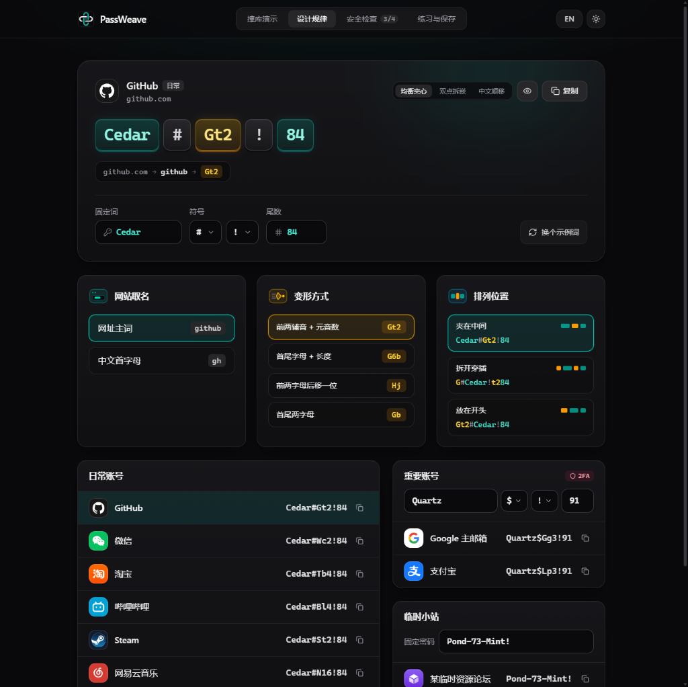
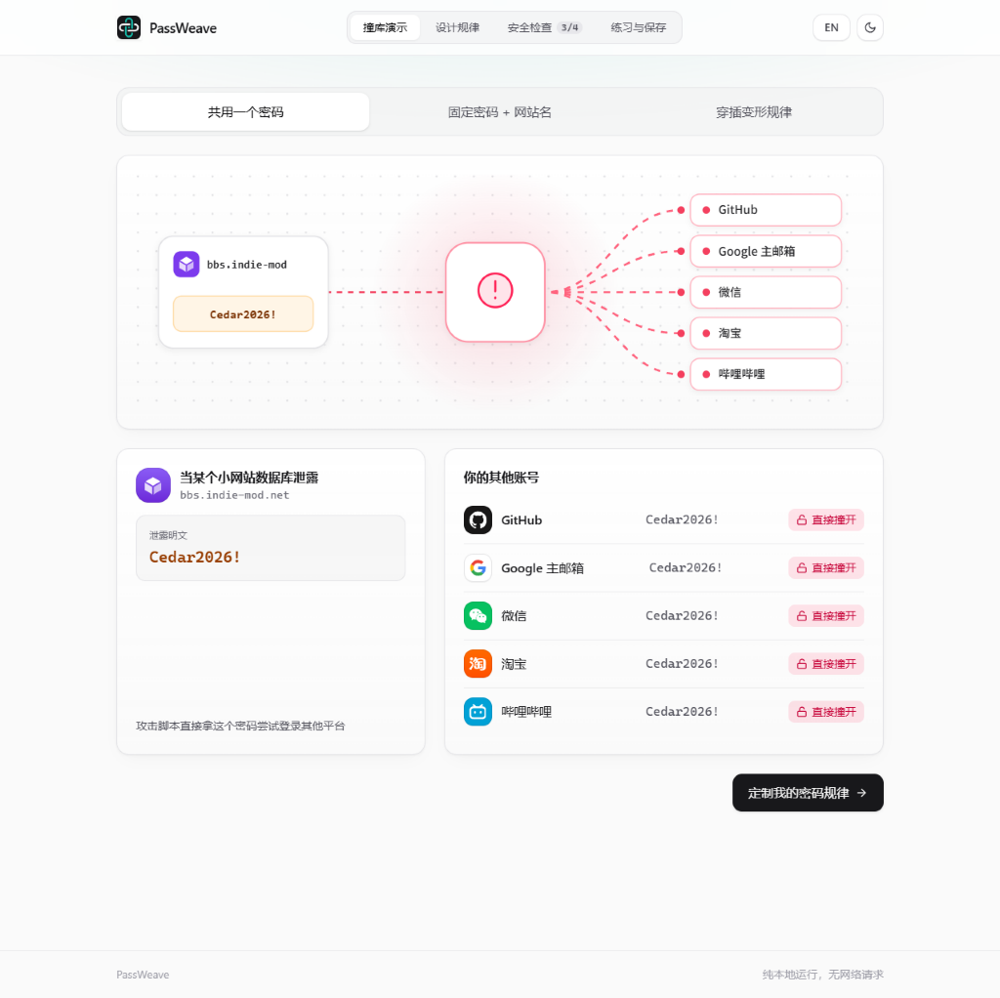

<div align="center">
  <a href="https://github.com/wy6692/passweave">
    
  </a>

  <h1 align="center">PassWeave</h1>

  <p align="center">
    Offline workbench for designing human-computable, breach-isolated password patterns.<br />
    Deterministic 3-second mental derivation · Three-tier blast-radius isolation · Zero network I/O
  </p>

  <p align="center">
    <a href="https://github.com/wy6692/passweave/actions/workflows/ci.yml"></a>
    <a href="./SECURITY.md"></a>
    <a href="./LICENSE"></a>
  </p>

  <p align="center">
    
    
    
    
    
    
  </p>

  <p align="center">
    <strong>English</strong> · <a href="./README.zh-CN.md">简体中文</a> · <a href="https://wy6692.github.io/passweave/">Live Demo</a> · <a href="./SECURITY.md">Security Policy</a> · <a href="./CONTRIBUTING.md">Contributing</a>
  </p>
</div>

<br />

<table>
  <tr>
    <td width="50%" align="center">
      
      <br />
      <sub><strong>Pattern Workbench</strong> — Dark Theme</sub>
    </td>
    <td width="50%" align="center">
      
      <br />
      <sub><strong>Credential-Stuffing Topology</strong> — Light Theme</sub>
    </td>
  </tr>
</table>

## Overview

Most memorable password habits fail under a single database leak: reusing one password hands attackers every account directly, while naive suffixes such as `MyPass_github` expose the base password in plaintext.

**PassWeave** provides an interactive, offline-first workbench for constructing a personal password derivation rule that can be computed mentally in about three seconds, hides literal domain names, and isolates high-risk and throwaway sites into separate security tiers.

## Derivation Pipeline

Every everyday password is derived deterministically through three lightweight steps:

| Step | Mechanism | Example (`github.com`) | Example (`taobao.com`) |
| :--- | :--- | :--- | :--- |
| **1. Canonical Site Key** | Extract registrable domain core or 2-letter phonetic code | `github.com` → `github` | `淘宝` → `tb` |
| **2. Non-Linear Compression** | Compress into a fixed-shape token (e.g., 2 consonants + vowel count) | `github` → `Gt2` | `taobao` → `Tb4` |
| **3. Structural Weaving** | Inlay or split the token across your personal base word & digits | `Cedar#Gt2!84` | `Cedar#Tb4!84` |

## Three-Tier Blast-Radius Isolation

| Tier | Account Scope | Strategy | Impact If Plaintext Leaks |
| :--- | :--- | :--- | :--- |
| **Critical** | Primary email, banking, password vault master | Separate base word + mandatory 2FA | Everyday leaks never reveal the critical base word |
| **Everyday** | Developer platforms, social, shopping | Primary woven pattern | Single-site credential stuffing fails across other platforms |
| **Throwaway** | Small forums, temporary downloads, trial signups | Single unrelated static decoy password | Zero pattern samples enter public breach corpora |

## Workspace Modules

- **Breach Cascade Simulator**: Visualizes how a single forum leak propagates across GitHub, Google, WeChat, Taobao, and Bilibili under password reuse, suffixing, and woven transforms.
- **Interactive Pattern Workbench**: Live 3D keycap anatomy, instant custom-domain lookup, preset topologies (`Center Inlay`, `Split Inlay`, `Prefix Bridge`), and per-site tier assignment.
- **Differential Security Check**: Evaluates character-class requirements, checks whether literal site names leak into output, and runs side-by-side two-site alignment diffs.
- **Recall Drill & Sanitized Rule Card**: Timed blind-typing practice across target platforms, plus PNG and Markdown reference cards that strip your personal base words before export.

## Tech Stack & Architecture

| Layer | Choice | Notes |
| :--- | :--- | :--- |
| **UI Runtime** | React 19 + TypeScript 5.7 | Strict typing across core derivation, audit, and storage modules |
| **Styling** | Tailwind CSS v4 | Custom tactile controls, adaptive Light/Dark palettes, zero external UI kit bloat |
| **Build & Bundler** | Vite 6 | Relative asset paths (`./`) for portable static hosting and local file execution |
| **Verification** | Vitest + ESLint 9 | Automated unit suites covering transforms, domain parsing, audit rules, and sanitized exports |
| **Network Policy** | Strict CSP (`connect-src 'none'`) | Enforced in production HTML bundles and verified in CI on every push |

## Getting Started

Requires **Node.js 20+** and **pnpm**.

```bash
git clone https://github.com/wy6692/passweave.git
cd passweave
pnpm install
pnpm dev
```

Run lint, typecheck, unit tests, and production bundle verification:

```bash
pnpm lint
pnpm typecheck
pnpm test
pnpm build
```

## Security & Scope

- **Password Managers First**: On personal trusted devices, always prefer a dedicated password manager (Bitwarden, 1Password, KeePassXC) with randomly generated credentials and Passkeys / 2FA.
- **Where PassWeave Fits**: Constructing memorable vault master passwords, logging in on shared or restricted workstations where browser extensions cannot be installed, and replacing password reuse habits.
- **Human-Computable Threat Boundary**: Mental rules are not cryptographic PRF/HMAC functions. If multiple everyday passwords leak in plaintext simultaneously, manual correlation can eventually recover the rule structure—making **Throwaway isolation** and **Critical base-word separation + 2FA** essential.
- **Zero Telemetry**: All computation runs locally in the browser. Workspace preferences stay in `localStorage` (`passweave:workspace:v1`) with one-click reset, and exported cards omit all secret anchors. See [SECURITY.md](./SECURITY.md) for details.

## License

Released under the [MIT License](./LICENSE).
