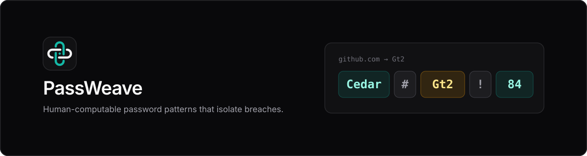

<p align="center">
  
</p>

<p align="center">
  <a href="./README.md">English</a> · <strong>简体中文</strong>
</p>

PassWeave（织密）是一个纯静态、零网络请求的浏览器端工作台，用于辅助设计和检验「人脑可 3 秒心算、防撞库、抗简单反推」的个人分级口令规律。

在实际场景中，跨设备盲打、受限办公终端登录、密码管理器主密码构造，或是习惯于「一套密码走天下 / 固定密码直接拼网站缩写」的用户，往往面临撞库与线性规律被脚本秒破的风险。PassWeave 通过可视化推演、模块化语法编织、双样本差分审计与脱敏助记卡导出，帮助用户建立一套脱离任何软件也能稳定默算的分级口令体系。

## 核心机制设计

### 1. 账号三级风险物理隔离

绝大多数明文或弱哈希脱库事件源自缺乏安全维护的小型论坛与临时注册站点。PassWeave 将账户划分为三个物理隔离层级，确保高危站点脱库不会泄露任何与日常规律相关的样本：

| 层级 | 覆盖范围 | 口令策略 |
| :--- | :--- | :--- |
| **Tier 1 · 核心级** | 主邮箱、银行支付、云账号根权限、密码库主口令 | 独立核心暗语词根 + 强制开启通行密钥 / 2FA 双重验证 |
| **Tier 2 · 日常级** | 常用开发、社交、电商、影音平台 | 套用主编织公式（每站唯一口令） |
| **Tier 3 · 抛弃级** | 小型资源论坛、临时注册下载站 | 固定且与个人暗语零字符重叠的一次性隔离口令 |

### 2. 平台唯一定名锚点

自创口令规律在半年后遗忘，通常是因为对同一平台的取名不一致（例如分不清当时用了 `bilibili`、`bili` 还是 `bzhan`）。PassWeave 引导用户在以下两种确定性标准中固定其一：

- **主域名核心词**：统一取公共后缀（`.com`、`.cn`、`.com.cn` 等）前一级的主域名单词，例如 `accounts.google.com` 取 `google`，`mail.163.com` 取 `163`。
- **双字拼音首字母**：统一按平台常用中文名称前两字取声母，例如 `淘宝` 取 `tb`，`微信` 取 `wx`。

### 3. 非线性特征编码与穿插拓扑

直接在固定密码末尾拼接 `taobao` 或 `github` 极易被自动化规则脚本剥离词根并批量推算其余平台口令。PassWeave 先将平台定名做非线性压缩，再穿插进拆分的个人暗语中：

| 特征提取规则 | 心算逻辑 | `github` | `taobao` | `163` |
| :--- | :--- | :--- | :--- | :--- |
| **前二辅音 + 元音计数** | 取前 2 个辅音（首大次小，不足补 `x`）+ 元音总数；纯数字取 `N` + 前两位 | `Gt2` | `Tb4` | `N16` |
| **首字母 + 字长 + 尾字母** | 首字符大写 + 核心词总长度 + 尾字符小写 | `G6b` | `T6o` | `133` |
| **前二字符顺移一位** | 取前 2 个字符在字母或数字表向后顺移 1 位（`z`→`a`，`9`→`0`） | `Hj` | `Ub` | `27` |
| **极简首尾双码** | 首字符大写 + 尾字符小写（建议配合双点拆嵌拓扑） | `Gb` | `To` | `13` |

配合**三明治内嵌式**（`Cedar#Gt2!84`）或**经纬双点拆嵌式**（`G#Cedar:t284`），生成的口令既不包含原域名词根，也能避免多个密码在泄露库按字母排序时因固定前缀而相邻聚集。

## 工作台模块构成

1. **撞库级联推演 (`01`)**：模拟高危小站明文脱库后，自动化撞库与后缀剥离脚本对「密码复用」「明文后缀拼接」「三级隔离非线性穿插」三种策略的真实攻击过程。
2. **规律编织台 (`02`)**：默认预填演练替身词（无需输入真实隐私即可演练），支持实时查看三步心算拆解与多平台输出矩阵，并可添加任意自定义网址验证。
3. **对抗与心算审计 (`03`)**：模拟两个日常级口令同时泄露时的明文差分特征，从字面隐蔽度、前缀聚类、差分槽位数、三级隔离、严苛策略兼容性及心算耗时六个维度给出量化评估与一键加固建议。
4. **盲打演练与脱敏助记卡 (`04`)**：提供带计时的随机站点盲打抽测，并支持通过本地 `Canvas` 导出完全剥离私人暗语的高清 PNG 与 Markdown 语法助记卡。

## 威胁模型与适用边界

- **专业密码管理器仍是首选方案**。在受信任的个人设备上，使用 Bitwarden、1Password 或 KeePassXC 生成 20 位以上全随机密码并开启 2FA / Passkey，具有最高的密码学强度。
- **PassWeave 的设计定位**。面向必须依赖人脑记忆的场景：构造高强度密码库主密码、在无法安装密码管理器的陌生或受限终端盲打登录，或帮助不愿使用密码管理器的用户彻底淘汰密码复用与弱后缀习惯。
- **安全性边界**。人脑可在数秒内完成的规则并非密码学单向哈希函数（不同于每次登录均需打开计算器派生的 LessPass）。若攻击者获取同一用户的多个日常级明文样本并针对性人工分析，仍存在结构被归纳的可能。因此，严格执行 **Tier 3 抛弃级物理隔离**与 **Tier 1 核心级独立暗语 + 2FA** 是该体系不可或缺的前提。

## 隐私与离线安全验证

- **浏览器内核级禁网策略**：生产构建产物在 HTML 头部内联了严格的 `Content-Security-Policy`（`default-src 'self'; connect-src 'none'; form-action 'none'`），从浏览器底层封死 `fetch`、`XHR`、WebSocket 及表单外发能力。
- **内存态零落盘**：工作台内的暗语输入仅存在于当前页面内存中，关闭标签页即销毁；`localStorage` 仅存储深浅色主题与中英文偏好。
- **极简运行时依赖**：生产环境仅依赖 `react`、`react-dom` 与 `lucide-react` 三个基础包，无任何统计埋点、外部字体或第三方脚本。

## 本地开发与构建

环境要求：Node.js 20+ 与 `pnpm`。

```bash
# 安装依赖
pnpm install

# 启动本地开发服务器
pnpm dev

# 运行核心算法与脱敏回归单测
pnpm test

# 运行代码规范与严格类型检查
pnpm lint
pnpm typecheck

# 构建静态离线生产包（输出至 dist/）
pnpm build
```

## 开源协议

本项目基于 [MIT License](./LICENSE) 协议开源。
