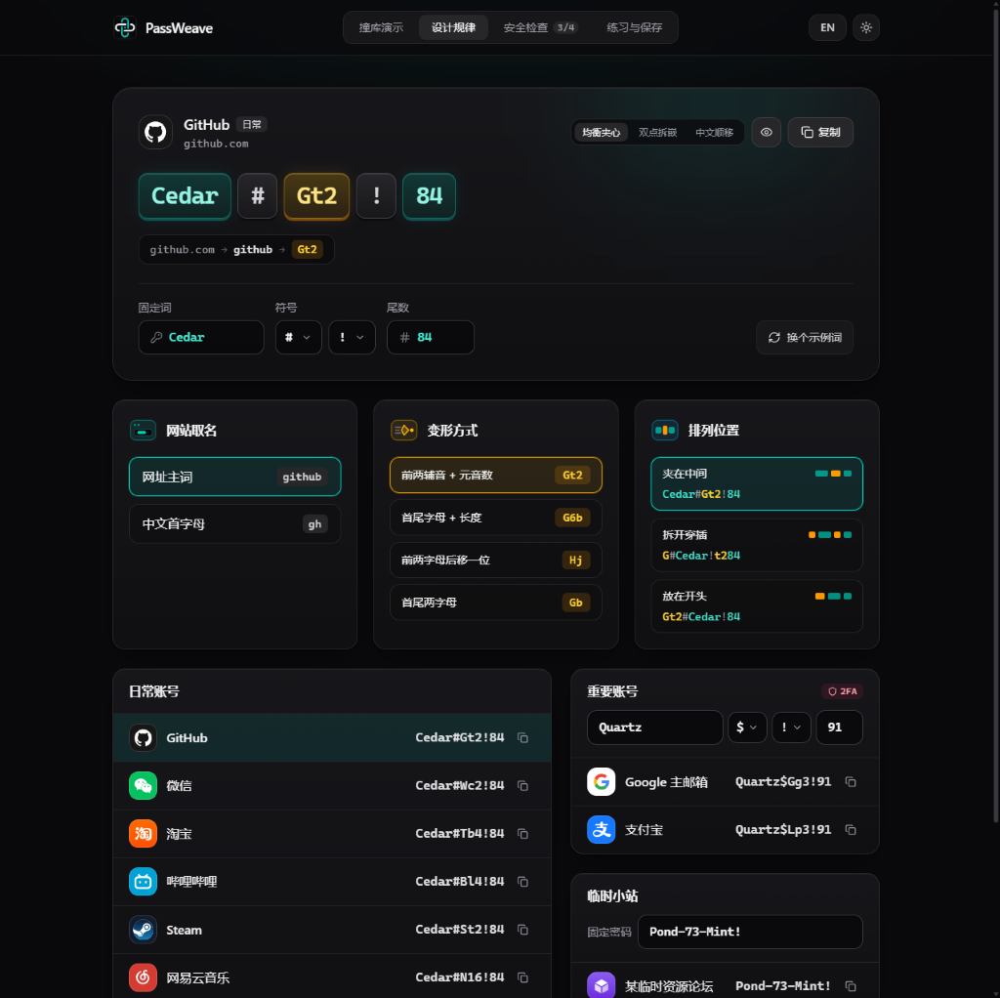
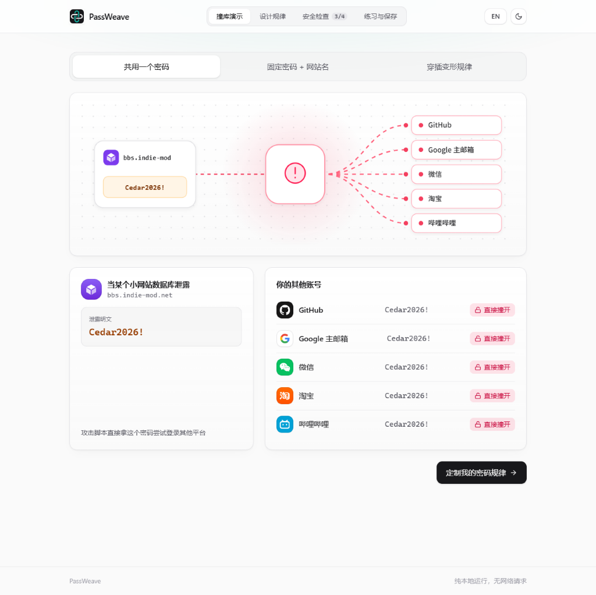

<div align="center">
  <a href="https://github.com/wy6692/passweave">
    
  </a>

  <h1 align="center">PassWeave</h1>

  <p align="center">
    纯本地运行的个人密码规律设计与防撞库演练工作台。<br />
    3 秒心算推导 · 三级账号风险隔离 · 零网络请求（CSP 锁死）
  </p>

  <p align="center">
    <a href="https://github.com/wy6692/passweave/actions/workflows/ci.yml"></a>
    <a href="./SECURITY.md"></a>
    <a href="./LICENSE"></a>
  </p>

  <p align="center">
    
    
    
    
    
    
  </p>

  <p align="center">
    <a href="./README.md">English</a> · <strong>简体中文</strong> · <a href="https://passweave.gazeo887.workers.dev/">在线预览</a> · <a href="./SECURITY.md">安全策略</a> · <a href="./CONTRIBUTING.md">参与贡献</a>
  </p>
</div>

<br />

<table>
  <tr>
    <td width="50%" align="center">
      
      <br />
      <sub><strong>设计规律工作台</strong> — 暗色主题</sub>
    </td>
    <td width="50%" align="center">
      
      <br />
      <sub><strong>撞库传播拓扑演示</strong> — 亮色主题</sub>
    </td>
  </tr>
</table>

## 项目简介

常见的个人设密习惯很难扛住单点脱库：「一套密码走天下」会让脚本直接撞开所有平台；而 `MyPass_taobao` 这类简单后缀拼写法，一旦泄露一条就会直接暴露你的固定底词。

**PassWeave** 提供一套可视化、纯离线的交互工作台，帮助你设计一条约 3 秒即可心算完成的个人密码规律：不直接拼写网站原名，并通过三级账号隔离控制脱库爆炸半径。

## 推导机制

每个日常网站的密码由固定三步确定性推导生成：

| 步骤 | 规则说明 | 示例（`github.com`） | 示例（`taobao.com`） |
| :--- | :--- | :--- | :--- |
| **1. 统一网站取名** | 按网址主词提取，或按中文名称双字母缩写 | `github.com` → `github` | `淘宝` → `tb` |
| **2. 非线性简短变形** | 压缩为定长特征码（如：前两辅音 + 元音数量） | `github` → `Gt2` | `taobao` → `Tb4` |
| **3. 穿插进固定底词** | 将网站码夹在底词与尾数中间，或拆开穿插 | `Cedar#Gt2!84` | `Cedar#Tb4!84` |

## 三级账号隔离

| 分级 | 适用账号 | 设密策略 | 单点脱库影响 |
| :--- | :--- | :--- | :--- |
| **重要账号** | 主邮箱、支付金融、密码库主密码 | 独立专用底词 + 强制开启双重验证（2FA） | 日常平台泄露不会暴露重要账号底词 |
| **日常账号** | 社交、代码托管、常规购物与影音平台 | 使用主规律推导 | 单个平台泄露无法直接撞开其他平台 |
| **临时小站** | 小型资源论坛、临时下载站、一次性试用 | 统一使用一个完全无关的固定密码 | 高危小站即使明文脱库，也不泄露任何规律样本 |

## 核心模块

- **撞库传播演示**：直观对比「共用一个密码」「固定密码 + 网站名」「穿插变形规律」在小网站脱库后的波及范围。
- **交互式规律工作台**：3D 键帽实时拆解结构、支持任意自定义网址速查、三种穿插拓扑切换与站点风险分级管理。
- **多样本比对安全检查**：自动检查字符种类合规性、检测密码中是否直接出现网站原词，并支持任意两站逐位对齐比对。
- **盲打练习与脱敏助记卡**：提供限时盲打回忆训练，支持导出自动剥离个人底词的 PNG 规律卡与 Markdown 备忘录。

## 技术栈与安全架构

| 层级 | 技术选型 | 说明 |
| :--- | :--- | :--- |
| **前端框架** | React 19 + TypeScript 5.7 | 核心推导引擎、安全审计与本地存储全链路严格类型约束 |
| **样式体系** | Tailwind CSS v4 | 全套自定义交互控件与亮/暗双主题适配，无第三方重型组件库依赖 |
| **构建工具** | Vite 6 | 采用相对路径（`./`）打包，支持任意静态托管环境与纯本地离线打开 |
| **质量保障** | Vitest + ESLint 9 | 单元测试覆盖域名归一化、变形算法、审计规则与导出脱敏校验 |
| **网络隔离** | CSP `connect-src 'none'` | 生产构建注入严格内容安全策略并在 CI 中自动校验，杜绝任何外部联网请求 |

## 本地开发

环境要求：**Node.js 20+** 与 **pnpm**。

```bash
git clone https://github.com/wy6692/passweave.git
cd passweave
pnpm install
pnpm dev
```

执行代码检查、类型校验、单元测试与生产构建：

```bash
pnpm lint
pnpm typecheck
pnpm test
pnpm build
```

通过 Wrangler 发布静态构建产物至 Cloudflare Workers（本地首次发布先执行 `pnpm cf:login`）：

```bash
pnpm cf:deploy
```

## 适用边界与安全说明

- **优先使用密码管理器**：在个人受信任设备上，始终优先推荐使用 Bitwarden、1Password、KeePassXC 等密码管理器生成高强度随机密码，并配合通行密钥（Passkey）或 2FA。
- **PassWeave 解决的场景**：构造好记且高强度的密码库主密码、在不便安装插件的公共或受限电脑上盲打登录，以及帮助习惯复用密码的用户建立基础隔离。
- **人脑心算规律的安全边界**：可心算规律不等同于密码学哈希函数。若多个日常网站同时明文泄露，人工比对多个样本仍可能反推出结构——因此务必把**临时小站**隔离开，并为**重要账号**单独设置底词与 2FA。
- **零遥测与本地持久化**：所有计算均在浏览器本地完成；工作区配置仅保存在当前浏览器 `localStorage`（`passweave:workspace:v1`，支持一键恢复默认），导出的助记卡不包含你填写的底词。详见 [SECURITY.md](./SECURITY.md)。

## 开源协议

基于 [MIT License](./LICENSE) 开源发布。
